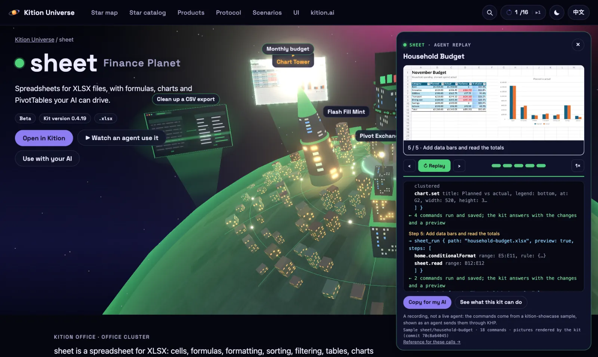
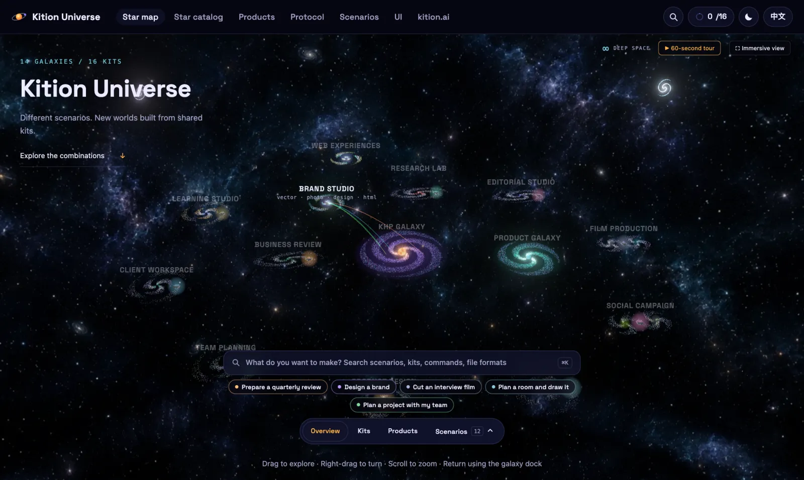

<div align="center">

# Kition Universe

Une carte stellaire en 3D de Kition, la suite professionnelle ouverte pour l’IA. Chaque kit est une planète : survolez, atterrissez et regardez un agent IA faire un vrai travail sur un vrai fichier.

**[Ouvrir Kition Universe → universe.kition.ai](https://universe.kition.ai)**

[English](README.md) · [简体中文](README.zh-CN.md) · [日本語](README.ja.md) · [한국어](README.ko.md) · [Deutsch](README.de.md) · **Français** · [Español](README.es.md) · [Português](README.pt-BR.md) · [Tiếng Việt](README.vi.md)

</div>

[](https://universe.kition.ai)

## De quoi s’agit-il

Kition réunit 16 éditeurs professionnels, appelés kits : documents, feuilles de calcul, diapositives, PDF, images, vidéo, dessin vectoriel, CAO, scènes 3D et plus encore. Chaque kit ouvre de vrais fichiers, et chacun peut être piloté par un agent IA grâce à un protocole ouvert, le Kit Harness Protocol (KHP).

Kition Universe permet de voir tout cela d’un coup d’œil. Il répond à trois questions : que peut produire chaque kit, comment une IA s’en sert-elle, et comment pouvez-vous vous en servir vous-même ?

## Ce que vous pouvez faire ici

### Visiter 16 planètes, une par kit

Chaque kit a son propre monde : une planète océan, une géante gazeuse, une ville en damier, un monde de lave. Cliquez sur une planète pour voir ce que le kit produit, puis atterrissez et parcourez sa ville, où chaque bâtiment correspond à quelque chose que le kit sait faire.

### Regarder un agent travailler

Lancez la lecture : les commandes envoyées par l’agent apparaissent une à une, à côté des images que le kit a rendues après chaque étape. Les bâtiments utilisés s’allument. À la fin, copiez le prompt et la configuration pour votre propre IA. Ce sont des enregistrements de vraies commandes de kit, pas un modèle en direct.



### Suivre un même travail d’un kit à l’autre

Douze galaxies de scénarios montrent comment les kits se combinent : un bilan d’activité passe du tableur au rapport, puis aux diapositives et au PDF signé. Un coursier porte le fichier de planète en planète, et les fichiers terminés se posent sur le pont des résultats.


### Partir de ce que vous voulez faire

Tapez « bilan trimestriel », « pivot » ou « .psd » et allez-y directement. La recherche couvre les scénarios, les kits, les capacités, les commandes d’agent et les formats de fichier. Elle s’exécute dans votre navigateur ; rien n’est envoyé.


### Voir ce que d’autres ont construit

Les produits construits sur les kits sont des planètes de la Galaxie des produits, reliées par la lumière aux kits qu’ils utilisent. L’inscription est gratuite, et toutes les planètes de produits ont la même taille.


### Voir comment tout est relié

Dans la vue d’ensemble, pointez une galaxie de scénario pour voir les lignes vers les planètes des kits qui la composent. Une visite de 60 secondes présente le protocole, un kit, un scénario et les produits.



## Les 16 kits

Chaque kit est une planète. Les kits marqués Preview sont encore en construction, et leurs planètes portent un échafaudage.

| Kit | Ce qu’il édite | Fichier | Sa planète |
| --- | --- | --- | --- |
| [**motion**](https://universe.kition.ai/planet/motion/) | Animation graphique | `.kmotion` | Monde de lave |
| [**note**](https://universe.kition.ai/planet/note/) | Notes Markdown reliées entre elles | `.md` | Géante gazeuse |
| [**table**](https://universe.kition.ai/planet/table/) | Tables structurées avec champs typés et vues | `.ktable` | Monde-ville |
| [**board**](https://universe.kition.ai/planet/board/) | Tableaux blancs et cartes mentales | `.kboard` | Monde océan |
| [**photo**](https://universe.kition.ai/planet/photo/) | Images en calques | `.psd` | Monde de tempêtes |
| [**film**](https://universe.kition.ai/planet/film/) | Montage vidéo | `.kfilm` | Géante gazeuse |
| [**doc**](https://universe.kition.ai/planet/doc/) | Documents de traitement de texte | `.docx` | Monde océan |
| [**sheet**](https://universe.kition.ai/planet/sheet/) | Feuilles de calcul | `.xlsx` | Monde-ville |
| [**slide**](https://universe.kition.ai/planet/slide/) | Présentations | `.kslide` | Géante gazeuse |
| [**pdf**](https://universe.kition.ai/planet/pdf/) | Pages PDF, formulaires et caviardage | `.pdf` | Roche à cratères |
| [**vector**](https://universe.kition.ai/planet/vector/) | Illustration vectorielle | `.kvector` | Monde de cristal |
| [**layout**](https://universe.kition.ai/planet/layout/) · Preview | Mise en page | `.klayout` | Monde de dunes |
| [**cad**](https://universe.kition.ai/planet/cad/) · Preview | Dessins techniques 2D | `.dxf` | Roche à cratères |
| [**html**](https://universe.kition.ai/planet/html/) · Preview | Pages web | `.html` | Monde de tempêtes |
| [**scene**](https://universe.kition.ai/planet/scene/) · Preview | Scènes 3D | `.kscene` | Monde océan |
| [**design**](https://universe.kition.ai/planet/design/) · Preview | Design d’interface | `.kdesign` | Monde de cristal |

## Bon à savoir

- Rien sur le site n’appelle un modèle d’IA. Les lectures sont des enregistrements de vraies commandes de kit ; les images ont été rendues par les kits.
- Votre progression (planètes visitées, lectures regardées) reste dans votre navigateur. Il n’y a pas de compte.
- Le site fonctionne sans WebGL : une carte statique et le même contenu, lectures comprises.
- Disponible en anglais et en chinois.

## Ajouter votre produit ou votre galaxie

Vous avez construit quelque chose sur les kits ? Cela peut devenir une planète de la Galaxie des produits. Vous avez une façon de travailler qui passe par plusieurs kits ? Proposez une galaxie de scénario. Les deux sont gratuits et passent par un formulaire d’issue.

- [Ajouter votre planète de produit](https://github.com/KitionAI/kition-universe/issues/new?template=built-with-kition.yml)
- [Proposer une galaxie de scénario](https://github.com/KitionAI/kition-universe/issues/new?template=scenario-galaxy.yml)
- [Les règles et le format](CONTRIBUTING.md)

## Pour les développeurs

Le site est statique : Astro, three.js et un fichier de données. Pour le lancer en local :

```bash
pnpm install
pnpm dev        # http://localhost:4330
```

Comment il est construit, vérifié et déployé : [docs/DEVELOPMENT.md](docs/DEVELOPMENT.md)

## Liens

- [Kition](https://kition.ai) · [GitHub](https://github.com/KitionAI/kition)
- [Kition SDK](https://github.com/KitionAI/kition-sdk)
- [Kit Harness Protocol](https://universe.kition.ai/protocol/)

## Licence

Apache-2.0
