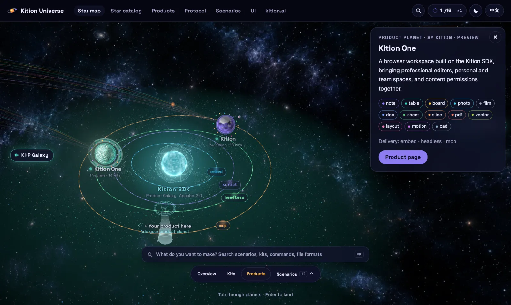

<div align="center">

# Kition Universe

Bản đồ sao 3D của Kition, bộ phần mềm chuyên nghiệp mở dành cho AI. Mỗi kit là một hành tinh: bay quanh, hạ cánh và xem một tác tử AI làm việc thật trên một tệp thật.

**[Mở Kition Universe → universe.kition.ai](https://universe.kition.ai)**

[English](README.md) · [简体中文](README.zh-CN.md) · [日本語](README.ja.md) · [한국어](README.ko.md) · [Deutsch](README.de.md) · [Français](README.fr.md) · [Español](README.es.md) · [Português](README.pt-BR.md) · **Tiếng Việt**

</div>

[](https://universe.kition.ai)

## Đây là gì

Kition gồm 16 trình chỉnh sửa chuyên nghiệp, gọi là kit: tài liệu, bảng tính, trang chiếu, PDF, hình ảnh, video, đồ họa vector, CAD, cảnh 3D và nhiều hơn nữa. Mỗi kit mở các tệp thật, và kit nào cũng có thể được một tác tử AI điều khiển qua một giao thức mở là Kit Harness Protocol (KHP).

Kition Universe là nơi để nhìn thấy tất cả những điều đó trong một lần. Nó trả lời ba câu hỏi: mỗi kit làm ra được gì, AI dùng kit như thế nào, và bạn có thể tự dùng ra sao.

## Bạn có thể làm gì ở đây

### Ghé thăm 16 hành tinh, mỗi kit một hành tinh

Mỗi kit có một thế giới riêng: hành tinh đại dương, hành tinh khí khổng lồ, thành phố ô lưới, thế giới dung nham. Nhấp vào một hành tinh để xem kit làm ra được gì, rồi hạ cánh và đi dạo trong thành phố của nó, nơi mỗi tòa nhà là một việc kit làm được.

### Xem tác tử làm việc

Nhấn phát và xem từng lệnh mà tác tử gửi đi, bên cạnh là hình ảnh kit kết xuất sau mỗi bước. Những tòa nhà đang được dùng sẽ sáng lên. Khi kết thúc, hãy sao chép câu lệnh và phần cấu hình cho AI của bạn. Đây là bản ghi các lệnh thật của kit, không phải một mô hình đang chạy trực tiếp.


### Theo một công việc đi qua nhiều kit

Mười hai thiên hà kịch bản cho thấy các kit kết hợp với nhau thế nào: một báo cáo kinh doanh đi từ bảng tính sang báo cáo, sang trang chiếu rồi đến tệp PDF đã ký. Một tàu vận chuyển mang tệp từ hành tinh này sang hành tinh khác, và các tệp hoàn chỉnh được đặt lên bệ kết quả.


### Bắt đầu từ việc bạn muốn làm

Gõ “báo cáo quý”, “pivot” hoặc “.psd” rồi bay thẳng đến đó. Có thể tìm kịch bản, kit, khả năng, lệnh của tác tử và định dạng tệp. Việc tìm kiếm chạy trong trình duyệt của bạn; không có gì được gửi đi.


### Xem người khác đã làm ra gì

Các sản phẩm xây trên kit là những hành tinh trong Thiên hà sản phẩm, nối bằng ánh sáng tới các kit mà chúng dùng. Việc đăng là miễn phí, và mọi hành tinh sản phẩm đều có cùng kích thước.



### Xem mọi thứ liên kết với nhau thế nào

Ở chế độ tổng quan, trỏ vào một thiên hà kịch bản để thấy các đường nối tới những hành tinh kit tạo nên nó. Chuyến tham quan 60 giây sẽ dẫn bạn qua giao thức, một kit, một kịch bản và các sản phẩm.


## 16 kit

Mỗi kit là một hành tinh. Các kit ghi Preview vẫn đang được xây dựng, và hành tinh của chúng có giàn giáo bao quanh.

| Kit | Chỉnh sửa gì | Tệp | Hành tinh |
| --- | --- | --- | --- |
| [**note**](https://universe.kition.ai/planet/note/) | Ghi chú Markdown liên kết với nhau | `.md` | Hành tinh khí khổng lồ |
| [**table**](https://universe.kition.ai/planet/table/) | Bảng có cấu trúc với trường có kiểu và các chế độ xem | `.ktable` | Thế giới thành phố |
| [**board**](https://universe.kition.ai/planet/board/) | Bảng trắng và sơ đồ tư duy | `.kboard` | Thế giới đại dương |
| [**photo**](https://universe.kition.ai/planet/photo/) | Hình ảnh nhiều lớp | `.psd` | Thế giới bão |
| [**film**](https://universe.kition.ai/planet/film/) | Dựng video | `.kfilm` | Hành tinh khí khổng lồ |
| [**doc**](https://universe.kition.ai/planet/doc/) | Tài liệu văn bản | `.docx` | Thế giới đại dương |
| [**sheet**](https://universe.kition.ai/planet/sheet/) | Bảng tính | `.xlsx` | Thế giới thành phố |
| [**slide**](https://universe.kition.ai/planet/slide/) | Bài trình chiếu | `.kslide` | Hành tinh khí khổng lồ |
| [**pdf**](https://universe.kition.ai/planet/pdf/) | Trang PDF, biểu mẫu và che nội dung | `.pdf` | Đá nhiều hố va chạm |
| [**vector**](https://universe.kition.ai/planet/vector/) | Minh họa vector | `.kvector` | Thế giới pha lê |
| [**layout**](https://universe.kition.ai/planet/layout/) · Preview | Dàn trang | `.klayout` | Thế giới cồn cát |
| [**motion**](https://universe.kition.ai/planet/motion/) | Đồ họa chuyển động | `.kmotion` | Thế giới dung nham |
| [**cad**](https://universe.kition.ai/planet/cad/) · Preview | Bản vẽ kỹ thuật 2D | `.dxf` | Đá nhiều hố va chạm |
| [**html**](https://universe.kition.ai/planet/html/) · Preview | Trang web | `.html` | Thế giới bão |
| [**scene**](https://universe.kition.ai/planet/scene/) · Preview | Cảnh 3D | `.kscene` | Thế giới đại dương |
| [**design**](https://universe.kition.ai/planet/design/) · Preview | Thiết kế giao diện | `.kdesign` | Thế giới pha lê |

## Điều nên biết

- Trang web không gọi bất kỳ mô hình AI nào. Các bản phát lại là bản ghi lệnh thật của kit; hình ảnh do kit kết xuất.
- Tiến trình của bạn (hành tinh đã ghé, bản phát lại đã xem) chỉ nằm trong trình duyệt. Không có tài khoản.
- Trang web vẫn dùng được khi không có WebGL: một bản đồ tĩnh với cùng nội dung, kể cả các bản phát lại.
- Có tiếng Anh và tiếng Trung.

## Thêm sản phẩm hoặc thiên hà của bạn

Bạn đã xây thứ gì đó trên các kit? Nó có thể trở thành một hành tinh trong Thiên hà sản phẩm. Bạn có một cách làm việc đi qua nhiều kit? Hãy đề xuất một thiên hà kịch bản. Cả hai đều miễn phí và được gửi qua biểu mẫu issue.

- [Thêm hành tinh sản phẩm của bạn](https://github.com/KitionAI/kition-universe/issues/new?template=built-with-kition.yml)
- [Đề xuất một thiên hà kịch bản](https://github.com/KitionAI/kition-universe/issues/new?template=scenario-galaxy.yml)
- [Quy tắc và định dạng](CONTRIBUTING.md)

## Dành cho nhà phát triển

Trang web là trang tĩnh: Astro, three.js và một tệp dữ liệu. Để chạy trên máy:

```bash
pnpm install
pnpm dev        # http://localhost:4330
```

Cách xây dựng, kiểm tra và phát hành: [docs/DEVELOPMENT.md](docs/DEVELOPMENT.md)

## Liên kết

- [Kition](https://kition.ai) · [GitHub](https://github.com/KitionAI/kition)
- [Kition SDK](https://github.com/KitionAI/kition-sdk)
- [Kit Harness Protocol](https://universe.kition.ai/protocol/)

## Giấy phép

Apache-2.0
