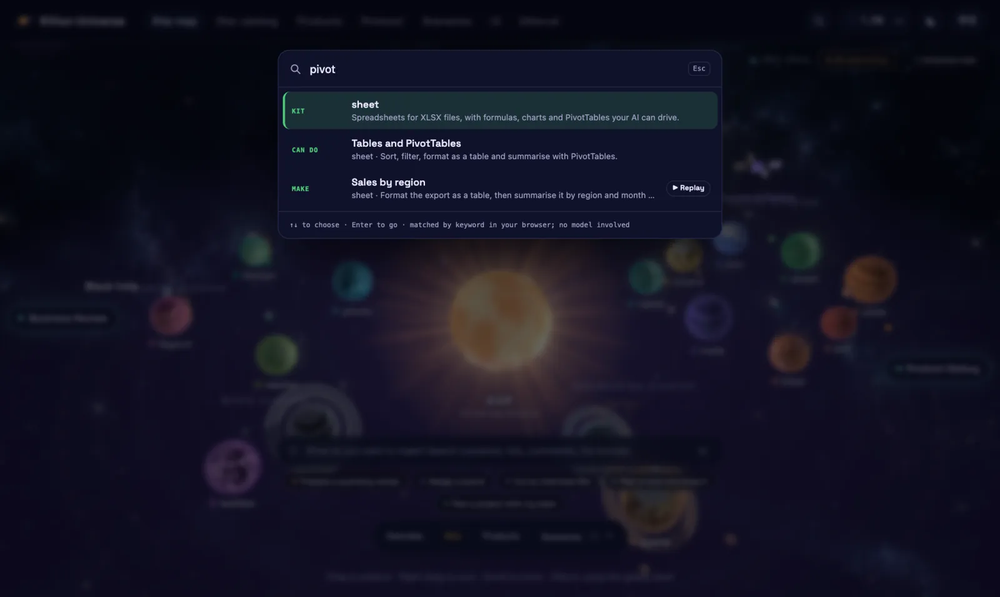

<div align="center">

# Kition Universe

Kition Universe: um mapa estelar em 3D do Kition, a suíte profissional aberta para IA. 16 planetas, um por kit, galáxias de cenários e gravações de agentes de IA fazendo trabalho de verdade em arquivos de verdade.

[universe.kition.ai](https://universe.kition.ai) · [Kition](https://kition.ai)

[English](../../README.md) · [简体中文](README.zh-CN.md) · [日本語](README.ja-JP.md) · [한국어](README.ko-KR.md) · [Deutsch](README.de-DE.md) · [Français](README.fr-FR.md) · [Español](README.es-ES.md) · **Português** · [Tiếng Việt](README.vi-VN.md)

</div>

[](https://universe.kition.ai)

## O que é

O Kition é um conjunto de 16 editores profissionais, chamados kits: documentos, planilhas, slides, PDFs, imagens, vídeo, desenho vetorial, CAD, cenas 3D e mais. Cada kit abre arquivos reais, e cada um pode ser operado por um agente de IA por meio de um protocolo aberto, o Kit Harness Protocol (KHP).

O Kition Universe é o lugar para ver tudo isso de uma vez. Ele responde a três perguntas: o que cada kit consegue criar, como uma IA o utiliza e como você mesmo pode utilizá-lo.

## O que você pode fazer aqui

### Visitar 16 planetas, um por kit

Cada kit tem seu próprio mundo: um planeta oceânico, um gigante gasoso, uma cidade em grade, um mundo de lava. Clique em um planeta para ver o que o kit cria; depois pouse e caminhe pela cidade, onde cada prédio é algo que o kit sabe fazer.

### Ver um agente trabalhando

Aperte reproduzir e veja os comandos que o agente envia, um a um, ao lado das imagens que o kit gerou depois de cada etapa. Os prédios em uso se acendem. No fim, copie o prompt e a configuração para a sua própria IA. São gravações de comandos reais dos kits, não um modelo ao vivo.


### Acompanhar um mesmo trabalho de kit em kit

Doze galáxias de cenários mostram como os kits se combinam: um relatório de negócios vai da planilha ao relatório, aos slides e ao PDF assinado. Um mensageiro leva o arquivo de planeta em planeta, e os arquivos prontos chegam à plataforma de resultados.


### Começar pelo que você quer fazer

Digite “relatório trimestral”, “tabela dinâmica” ou “.psd” e voe direto para lá. A busca cobre cenários, kits, capacidades, comandos de agente e formatos de arquivo. Ela roda no seu navegador; nada é enviado.



### Ver o que outras pessoas criaram

Os produtos criados sobre os kits são planetas da Galáxia de produtos, ligados por luz aos kits que utilizam. A listagem é gratuita, e todos os planetas de produto têm o mesmo tamanho.


### Ver como tudo se conecta

Na visão geral, aponte para uma galáxia de cenário para ver as linhas até os planetas dos kits que a formam. Um tour de 60 segundos passa pelo protocolo, por um kit, por um cenário e pelos produtos.


## Os 16 kits

Cada kit é um planeta. Os kits marcados como Preview ainda estão em construção, e seus planetas têm andaimes.

| Kit | O que edita | Arquivo | Seu planeta |
| --- | --- | --- | --- |
| [**motion**](https://universe.kition.ai/planet/motion/) | Motion graphics | `.kmotion` | Mundo de lava |
| [**note**](https://universe.kition.ai/planet/note/) | Notas em Markdown ligadas entre si | `.md` | Gigante gasoso |
| [**table**](https://universe.kition.ai/planet/table/) | Tabelas estruturadas com campos tipados e visualizações | `.ktable` | Mundo-cidade |
| [**board**](https://universe.kition.ai/planet/board/) | Quadros brancos e mapas mentais | `.kboard` | Mundo oceânico |
| [**photo**](https://universe.kition.ai/planet/photo/) | Imagens em camadas | `.psd` | Mundo de tempestades |
| [**film**](https://universe.kition.ai/planet/film/) | Edição de vídeo | `.kfilm` | Gigante gasoso |
| [**doc**](https://universe.kition.ai/planet/doc/) | Documentos de texto | `.docx` | Mundo oceânico |
| [**sheet**](https://universe.kition.ai/planet/sheet/) | Planilhas | `.xlsx` | Mundo-cidade |
| [**slide**](https://universe.kition.ai/planet/slide/) | Apresentações | `.kslide` | Gigante gasoso |
| [**pdf**](https://universe.kition.ai/planet/pdf/) | Páginas de PDF, formulários e tarjas | `.pdf` | Rocha com crateras |
| [**vector**](https://universe.kition.ai/planet/vector/) | Ilustração vetorial | `.kvector` | Mundo de cristal |
| [**layout**](https://universe.kition.ai/planet/layout/) | Diagramação | `.klayout` | Mundo de dunas |
| [**cad**](https://universe.kition.ai/planet/cad/) | Desenho técnico 2D | `.dxf` | Rocha com crateras |
| [**html**](https://universe.kition.ai/planet/html/) · Preview | Páginas web | `.html` | Mundo de tempestades |
| [**scene**](https://universe.kition.ai/planet/scene/) · Preview | Cenas 3D | `.kscene` | Mundo oceânico |
| [**design**](https://universe.kition.ai/planet/design/) · Preview | Design de interface | `.kdesign` | Mundo de cristal |

## Bom saber

- Nada no site chama um modelo de IA. As reproduções são gravações de comandos reais dos kits; as imagens foram geradas pelos kits.
- Seu progresso (planetas visitados, reproduções assistidas) fica no seu navegador. Não há contas.
- O site funciona sem WebGL: um mapa estático e o mesmo conteúdo, incluindo as reproduções.
- Disponível em inglês e chinês.

## Adicione seu produto ou sua galáxia

Criou algo sobre os kits? Isso pode virar um planeta na Galáxia de produtos. Tem um jeito de trabalhar que passa por vários kits? Proponha uma galáxia de cenário. As duas coisas são gratuitas e chegam por um formulário de issue.

- [Adicionar seu planeta de produto](https://github.com/KitionAI/kition-universe/issues/new?template=built-with-kition.yml)
- [Propor uma galáxia de cenário](https://github.com/KitionAI/kition-universe/issues/new?template=scenario-galaxy.yml)
- [As regras e o formato](../../.github/CONTRIBUTING.md)

## Compilar e testar

O site é estático: Astro, three.js e um arquivo de dados. Para rodar localmente:

```bash
pnpm install
pnpm dev        # http://localhost:4330
```

Como ele é construído, verificado e publicado: [docs/DEVELOPMENT.md](../DEVELOPMENT.md)

## Links

- [Kition](https://kition.ai) · [GitHub](https://github.com/KitionAI/kition)
- [Kition SDK](https://github.com/KitionAI/kition-sdk) · [Documentação para desenvolvedores](https://developer.kition.ai)
- [Kit Harness Protocol](https://universe.kition.ai/protocol/)

## Licença

Apache-2.0
