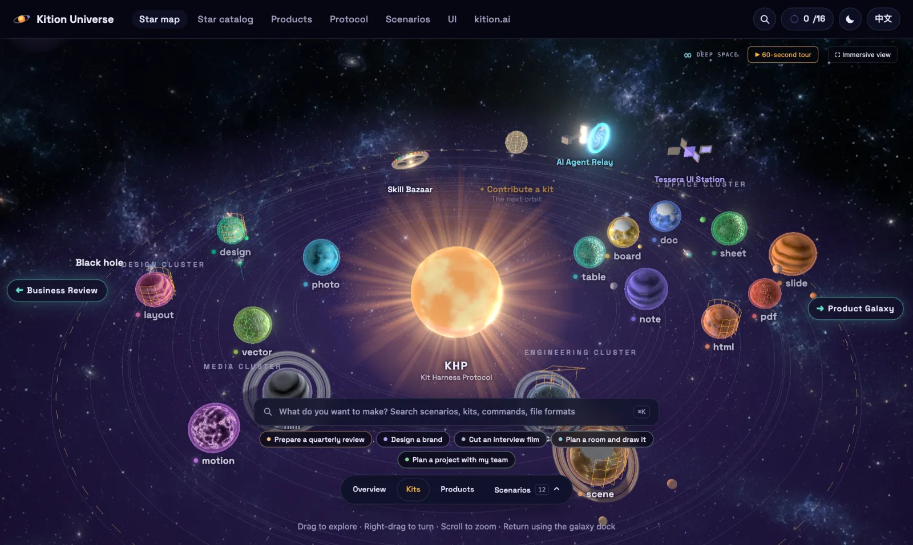
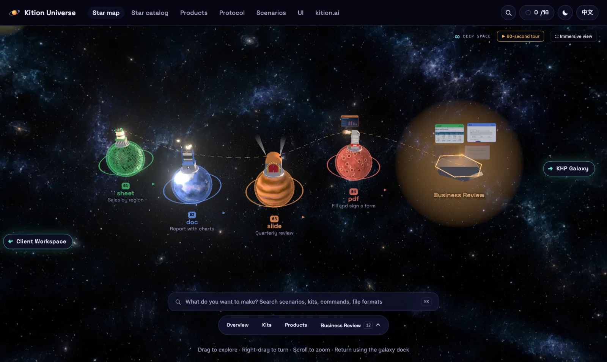

<div align="center">

# Kition Universe

Kition Universe：Kition 的 3D 星图，Kition 是为 AI 准备的开源专业软件套件。16 颗 kit 星球、场景星系，以及 AI Agent 在真实文件上干活的录制回放。

[universe.kition.ai](https://universe.kition.ai) · [Kition](https://kition.ai)

[English](../../README.md) · **简体中文** · [日本語](README.ja-JP.md) · [한국어](README.ko-KR.md) · [Deutsch](README.de-DE.md) · [Français](README.fr-FR.md) · [Español](README.es-ES.md) · [Português](README.pt-BR.md) · [Tiếng Việt](README.vi-VN.md)

</div>

[](https://universe.kition.ai)

## 这是什么

Kition 是 16 个专业编辑器，我们叫它 kit：文档、电子表格、幻灯片、PDF、图像、视频、矢量图、CAD、三维场景等等。每个 kit 都直接打开真实文件，也都能通过同一个开放协议 Kit Harness Protocol（KHP）交给 AI Agent 来操作。

Kition Universe 让你一眼看清这一切。它回答三个问题：每个 kit 能做出什么，AI 是怎么用它的，你自己又可以怎么用。

## 在这里可以做什么

### 逛 16 颗星球，一个 kit 一颗

每个 kit 有自己的世界：海洋星球、气态巨行星、城市网格、熔岩星球。点一颗星球看它能做什么，再降落下去逛它的城市，城里每栋建筑都是这个 kit 的一项能力。

### 看 AI Agent 干活

按下播放，Agent 发出的命令一条条出现，旁边是 kit 在每一步之后渲染出来的图，用到的建筑会亮起来。播完可以把提示词和接入配置复制给你自己的 AI。这些是真实 kit 命令的录制回放，不是实时的模型。


### 跟着一份工作穿过几个 kit

12 个场景星系展示 kit 怎么配合：一份经营汇报从表格到报告，再到幻灯片，最后是签好的 PDF。货船把文件从一颗星球运到下一颗，成品落在成品台上。



### 从你想做的事出发

输入“季度汇报”“数据透视”或“.psd”，直接飞过去。可以搜场景、kit、能力、Agent 命令和文件格式。搜索在浏览器里完成，不会把任何内容发出去。


### 看别人做了什么

用 kit 做出来的产品是产品星系里的星球，用光缆连到它用到的 kit。收录免费，所有产品星球一样大。


### 看清它们之间的关系

在总览里指向一个场景星系，会画出它和所用 kit 星球之间的连线。60 秒导览带你看一遍协议、一个 kit、一个场景和产品。


## 16 个 kit

每个 kit 是一颗星球。标着 Preview 的还在建设中，星球外面搭着脚手架。

| Kit | 编辑什么 | 文件 | 它的星球 |
| --- | --- | --- | --- |
| [**motion**](https://universe.kition.ai/planet/motion/) | 动态图形 | `.kmotion` | 熔岩星球 |
| [**note**](https://universe.kition.ai/planet/note/) | 互相链接的 Markdown 笔记 | `.md` | 气态巨行星 |
| [**table**](https://universe.kition.ai/planet/table/) | 带字段类型和视图的结构化表格 | `.ktable` | 城市星球 |
| [**board**](https://universe.kition.ai/planet/board/) | 白板和思维导图 | `.kboard` | 海洋星球 |
| [**photo**](https://universe.kition.ai/planet/photo/) | 分层图像 | `.psd` | 风暴星球 |
| [**film**](https://universe.kition.ai/planet/film/) | 视频剪辑 | `.kfilm` | 气态巨行星 |
| [**doc**](https://universe.kition.ai/planet/doc/) | 文字处理文档 | `.docx` | 海洋星球 |
| [**sheet**](https://universe.kition.ai/planet/sheet/) | 电子表格 | `.xlsx` | 城市星球 |
| [**slide**](https://universe.kition.ai/planet/slide/) | 演示文稿 | `.kslide` | 气态巨行星 |
| [**pdf**](https://universe.kition.ai/planet/pdf/) | PDF 页面、表单和涂黑 | `.pdf` | 陨石坑岩石星 |
| [**vector**](https://universe.kition.ai/planet/vector/) | 矢量插画 | `.kvector` | 晶体星球 |
| [**layout**](https://universe.kition.ai/planet/layout/) | 版式排版 | `.klayout` | 沙丘星球 |
| [**cad**](https://universe.kition.ai/planet/cad/) | 二维工程制图 | `.dxf` | 陨石坑岩石星 |
| [**html**](https://universe.kition.ai/planet/html/) · Preview | 网页 | `.html` | 风暴星球 |
| [**scene**](https://universe.kition.ai/planet/scene/) · Preview | 三维场景 | `.kscene` | 海洋星球 |
| [**design**](https://universe.kition.ai/planet/design/) · Preview | 界面设计 | `.kdesign` | 晶体星球 |

## 需要知道的

- 站点不调用任何 AI 模型。回放是真实 kit 命令的录制，图片由 kit 渲染。
- 探索进度（到过的星球、看过的回放）只存在你的浏览器里，没有账号。
- 没有 WebGL 也能用：显示静态星图，内容一样，回放也能看。
- 提供英文和中文。

## 登记你的产品或星系

用 kit 做了产品？它可以成为产品星系里的一颗星球。有一种要经过几个 kit 的工作方式？可以提议一个场景星系。两者都免费，通过 issue 表单提交。

- [登记你的产品星球](https://github.com/KitionAI/kition-universe/issues/new?template=built-with-kition.yml)
- [提议一个场景星系](https://github.com/KitionAI/kition-universe/issues/new?template=scenario-galaxy.yml)
- [规则和格式](../../.github/CONTRIBUTING.md)

## 构建和测试

站点是静态的：Astro、three.js 和一个数据文件。本地运行：

```bash
pnpm install
pnpm dev        # http://localhost:4330
```

怎么构建、检查和发布： [docs/DEVELOPMENT.md](../DEVELOPMENT.md)

## 链接

- [Kition](https://kition.ai) · [GitHub](https://github.com/KitionAI/kition)
- [Kition SDK](https://github.com/KitionAI/kition-sdk) · [开发者文档](https://developer.kition.ai)
- [Kit Harness Protocol](https://universe.kition.ai/protocol/)

## 许可证

Apache-2.0
